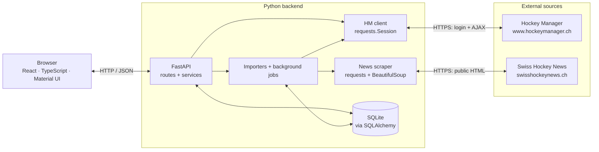
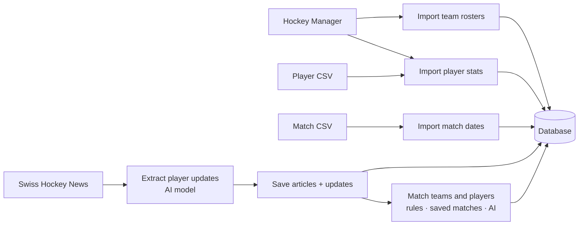

# Architecture

Hockey BI collects Swiss fantasy hockey data, keeps its history, and displays player stats, team value, transfer comparisons, and news.

> **Your Hockey Manager password is not saved unless you enable autolineup.**
> During normal use, it stays in browser memory and passes through the backend to authenticate with Hockey Manager. Reloading the page or logging out clears it from the app's browser state.
>
> Autolineup saves an encrypted copy in the database so the backend can sign in while you are away. Disabling autolineup deletes that saved copy.

**App structure and external connections**

| Source | How the backend connects |
| --- | --- |
| Hockey Manager | POST credentials to `/ajaxrequest/try-login`, keep session cookies in memory, then fetch stats and rosters or request autolineup through AJAX endpoints. Parse returned HTML with BeautifulSoup. |
| Swiss Hockey News | GET the public National League listing and new article pages, then parse their HTML. No login is needed. |

Player-stat imports use the operator's configured `HM_USER` / `HM_PASSWORD`; personal team requests use the user's credentials. Both clients close their sessions after use.

Vite builds the frontend. Its TypeScript client is generated from FastAPI's OpenAPI schema; React contexts share player stats and team data.

**Data flow**

News processing uses Pydantic AI with OpenAI or Ollama. Updates remain readable even when no player match is found.

| Action | What happens |
| --- | --- |
| Import data | Admin actions or the loader CLI collect data. Admin jobs run one at a time in a backend thread; results and errors are saved in `TASK`. |
| Load a team | Credentials are checked with Hockey Manager. Rosters refresh after 10 minutes, or when forced. |
| Compare transfers | The backend combines roster history, player stats, and match dates to calculate team value and simulated replacements. |
| Run autolineup | An admin job calls Hockey Manager's autolineup for managers who opted in, using their encrypted saved passwords. |

Player records belong to a season. Stats keep dated snapshots; roster entries record when players join and leave. News updates link to an article and, when matched, a player and season.

**Where the code lives**

| Path | Role |
| --- | --- |
| [frontend/src/](frontend/src/) | Pages, components, shared state, and generated API client. |
| [api/](backend/src/hmtracker/api/) | HTTP routes, request validation, and admin token authentication. |
| [services/](backend/src/hmtracker/services/) | Team calculations, login checks, and background jobs. |
| [parser/](backend/src/hmtracker/parser/) + [loader/](backend/src/hmtracker/loader/) | Fetch, parse, match, and import external data. |
| [database/](backend/src/hmtracker/database/) + [migrations/](backend/migrations/) | Models, queries, and schema changes. |

Local setup: [Readme.md](Readme.md).
